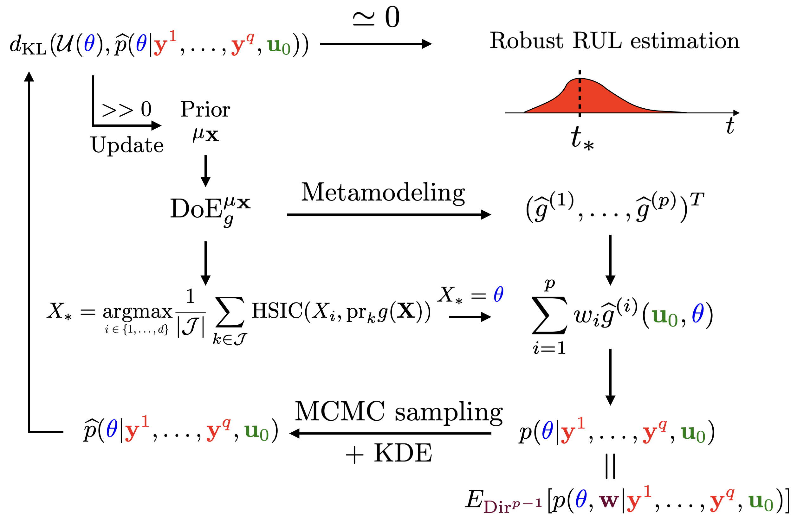

# Introduction

This is the reproducible code for the paper *Fusion of heterogeneous data for robust degradation prognostics* published in Reliability Engineering and System Safety, available [in open acess](https://doi.org/10.1016/j.ress.2026.112435).

To cite this work, please use the following BibTeX entry:
```
@article{Jaber2026,
    title   = {{Fusion of heterogeneous data for robust degradation prognostics}},
    author  = {Jaber, E. and Remy, E. and Chabridon, V. and Mougeot, M. and Lucor, D.}
    journal = {Reliability Engineering \& System Safety},
    doi     = {https://doi.org/10.1016/j.ress.2026.112435},
    pages   = {112435},
    year    = {2026},
}
```
This article proposes a methodology for assimilating sparse and heterogeneous degradation data into a simulation model. It relies on kernel sensitivity analysis HSIC-based indices as well as a specific Bayesian likelihood using different priors for the noise. It then makes use of RWMH-MCMC for sampling in this tailored posterior distribution. 
If the degradation simulation model is expensive to evaluate, we rely on Karhunèn-Loève-based time-varying surrogate models and the methodology can also integrate multiple equally valid surrogates to overcome possible surrogate bias. Robust prediction of probabilistic remaining useful life for the asset under consideration can then be made.



The methodology is packaged as an application-independent Python library, [`bayes_fusion`](bayes_fusion), and the two cases of the article are applications built on top of it.

# Requirements

Create the following conda environment and install the package:
```
conda env create -f environment.yml
conda activate bayes-fusion
pip install -e .
```
The essential Python library used for the different scripts is the UQ library: [OpenTURNS 1.24](https://github.com/openturns/openturns?tab=GPL-3.0-2-ov-file#).


# Repository layout
```
bayes_fusion/                  the methodology, independent of any application
examples/crack_growth/         toy example: Paris-Erdogan crack growth (self-contained notebook)
applications/sg_clogging/      steam-generator clogging application (data not distributed)
tests/                         unit tests of the package
legacy/                        the code as published with the article (kept for reproducibility)
```

# The package: `bayes_fusion`
- [metamodels.py](bayes_fusion/metamodels.py): implements scalar Gaussian process metamodels, non-intrusive vector polynomial chaos expansions as well as Karhunèn-Loève field metamodels. All classes come with the scikit-learn methods ```.fit()``` and ```.predict()``` syntax
- [hsic.py](bayes_fusion/hsic.py): Python class for computing HSIC indices (regular, target and conditional)
- [mcmc.py](bayes_fusion/mcmc.py): RWMH-MCMC sampling of the posterior distribution as explained in the article. When several surrogates are available, the likelihood aggregates them over a fixed scrambled-Sobol design of weights on the simplex (log-sum-exp), so that it is a deterministic function of the calibrated parameter
- [assimilation.py](bayes_fusion/assimilation.py): the refine-until-converged calibration loop for one scenario (HSIC screening, surrogate ensemble, MCMC, Kullback-Leibler stopping rule)
- [smoothing.py](bayes_fusion/smoothing.py), [prognostics.py](bayes_fusion/prognostics.py): ensemble Kalman smoother and remaining-useful-life utilities
- [screening.py](bayes_fusion/screening.py), [surrogates.py](bayes_fusion/surrogates.py), [restriction.py](bayes_fusion/restriction.py), [config.py](bayes_fusion/config.py): active-variable selection, construction of the surrogate ensembles, restriction of a model to the calibrated parameter, and the configuration dataclasses

# Applications

We run our methodology on two cases:
-    The Paris-Erdogan's law which is an ODE-based degradation model of crack propagation. We run the methodology on a fictitious material with an explicit Euler implementation of the model, available in [this notebook](examples/crack_growth/crack_growth_paris_law.ipynb). It is self-contained and runs in well under a minute.
- The THYC-Puffer-DEPO clogging simulator for steam generators in pressurized-water-reactors, in [applications/sg_clogging](applications/sg_clogging). To protect the industrial secrecy, the clogging data are **not** distributed with this repository (the `applications/sg_clogging/DATA` folder is git-ignored, see end of README). The two steam generators are called SG A and SG B, with their own failure thresholds $\tau_c^{\ast,A}$ and $\tau_c^{\ast,B}$ (kept with the data). The application provides the full-data run, the ESTICOL observation-size sweep and the kinetics experiment (one `run.sh` launcher), the notebooks used to analyse them, and the preprocessing figures of the article in `figures/`.

The code of the article as published is kept in [legacy](legacy).

# License
This repository is issued under the same licenses as [OpenTURNS](https://github.com/openturns/openturns?tab=GPL-3.0-2-ov-file#), namely LGPL-3.0 license.


To request the clogging data, write to
```
{surname}.{lastname}@edf.fr
```
where 
```surname = vincent, emmanuel``` 
 & ```lastname = chabridon, remy```
